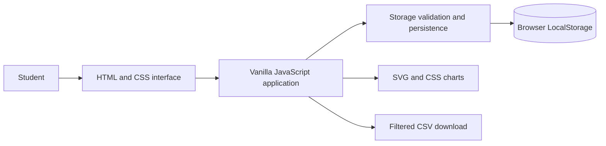
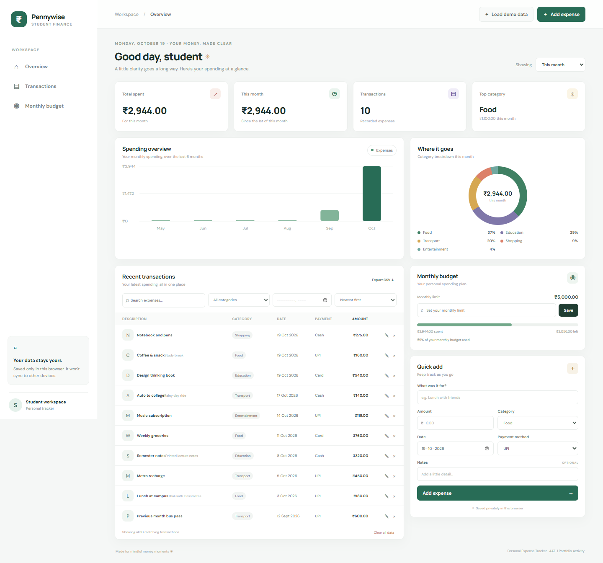
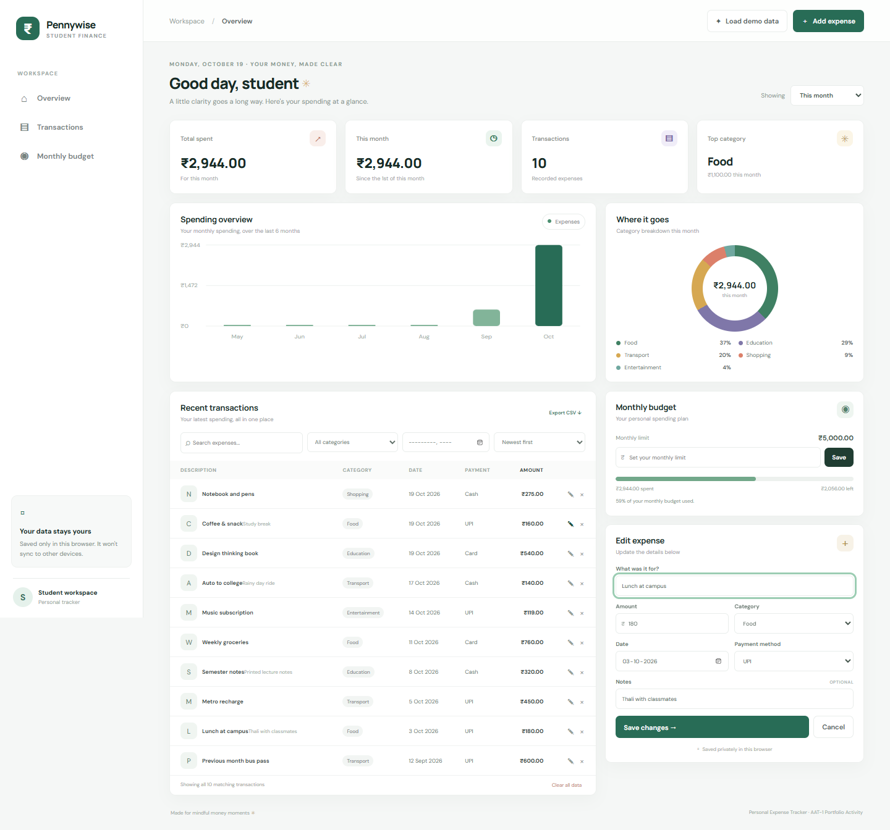
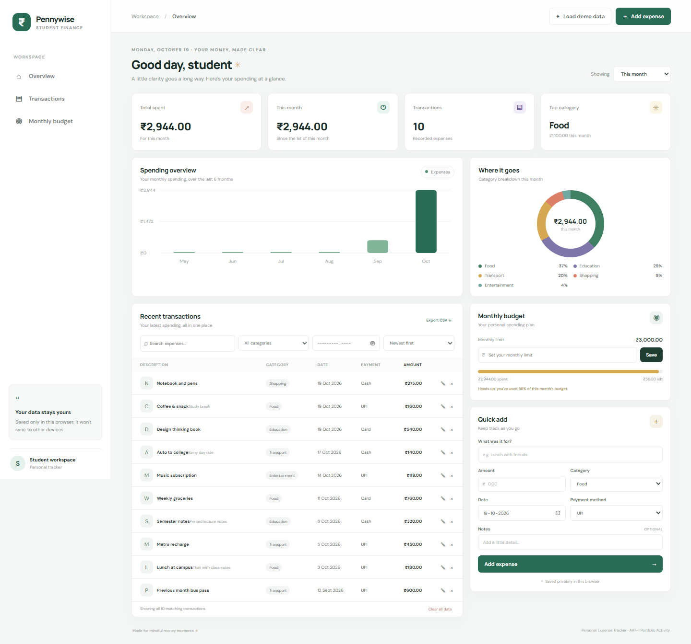

# Personal Expense Tracker

**A Web Application for Recording and Analysing Student Expenses**

A lightweight, responsive expense tracker for students. Record everyday spending, review category and month summaries, and keep a simple monthly spending plan. The application uses HTML, CSS, vanilla JavaScript, SVG, and browser LocalStorage; it has no server, database, account, or external API.

> **Privacy and portability:** Data is kept in LocalStorage for this browser profile on this device. It is not encrypted by this app, backed up, or synchronized to another browser or device. Export a CSV if you want a portable copy.

## Project overview

Students often make small purchases throughout the day and can lose track of how those purchases add up. This project provides one simple place to record expenses and review spending patterns without requiring an account or paid service.

### Objectives

- Provide a clear dashboard with period totals, monthly totals, transaction counts, and the leading category.
- Make recording, editing, searching, filtering, sorting, and exporting expenses straightforward.
- Visualize monthly and category spending using lightweight SVG and CSS charts.
- Let students set a monthly spending limit and see progress and threshold warnings.
- Demonstrate a responsive client-side application with persistent browser storage.

## Features

- Dashboard totals for this month, the last 30 days, or all recorded time.
- A six-month spending chart, current-month category breakdown, and recent/complete transaction list.
- Expense form with title, positive rupee amount, category, date, payment method, and optional notes.
- Edit and confirmed delete actions; search by title; category and month filters; date and amount sorting.
- Monthly budget progress, an 80% warning, and an exceeded-budget alert.
- LocalStorage persistence with input validation and recovery from malformed saved records.
- Idempotent demo-data loading, CSV export of the currently filtered transactions, and confirmed clear-data action.
- Responsive layout, keyboard focus indicators, accessible labels, and live status notifications.

## Technology and architecture

| Technology | Purpose |
| --- | --- |
| HTML5 | Semantic application structure and accessible form controls |
| CSS3 | Responsive layout, visual design, and budget/chart styling |
| Vanilla JavaScript | Validation, interactions, filtering, calculations, CSV export, and rendering |
| SVG and CSS | Dependency-free monthly bars and category doughnut chart |
| Browser LocalStorage | Browser-specific storage for expenses and the monthly budget |



## Data design

The application currently uses these versioned keys:

- `pennywise.expenses.v1` — JSON array of expenses. Each saved object has `id`, `title`, `amount` (INR number), `category`, `date` (`YYYY-MM-DD`), `payment`, and `notes`.
- `pennywise.monthlyBudget.v1` — JSON number representing the monthly spending limit in INR.

The app validates values before using or saving them. Invalid expense records are skipped with a notice; malformed arrays/budgets are handled without crashing the page. LocalStorage is not a database and is limited to the current browser profile.

## Run locally

No build step or package installation is required.

1. Open `index.html` directly in a modern browser, or open the project folder in VS Code and use a static web server such as the **Live Server** extension.
2. Use **Load demo data** to populate a sample dashboard, or add expenses with the form.
3. Data remains after refresh in the same browser profile.

If opening files directly is restricted by a browser, run this from the project folder:

```powershell
python -m http.server 8000
```

Then open `http://localhost:8000`. The app does not make network requests for data. Google Fonts are an optional presentation enhancement; system fonts are used if unavailable.

## Using the application

- **Add:** Complete the Quick add form and select **Add expense**. Amounts must be greater than zero.
- **Edit:** Select the pencil button in a transaction row, update the form, and save changes.
- **Delete:** Select the × button and confirm the browser dialog.
- **Search and filter:** Search title text, choose a category and/or month, then choose a sort order. The table shows all matching transactions.
- **Budget:** Enter a monthly INR spending limit and save. Progress is based on expenses dated in the current calendar month. At 80%, the tracker shows a warning; spending above the limit shows the amount exceeded.
- **Export:** **Export CSV** downloads the currently filtered transaction list. CSV cells are quoted and values beginning with spreadsheet formula characters are escaped.
- **Demo data:** Select **Load demo data**. Stable sample IDs ensure repeated clicks do not add duplicate sample records.
- **Clear:** Select **Clear all data** and confirm to remove expenses and the budget from this browser.

## Screenshots

These screenshots were captured from the running application with realistic demo data:

### Dashboard


### Transaction management and edit form


### Budget and analytics


## Testing and verification

Verified in a headless Microsoft Edge browser using Playwright. **22 of 22 checks passed**, covering application startup and JavaScript errors; demo loading without duplicates; positive-amount validation; add/edit/delete and persistence after refresh; search, category/month filters, and sorting; data-derived dashboard totals and both charts; budget progress, the 80% warning, and exceeded-budget alert; filtered CSV content; clear-data confirmation; corrupt and empty LocalStorage handling; empty state; and a 390 px mobile viewport with no page-level horizontal overflow. No project dependency or build step is needed.

## Limitations and future enhancements

### Known limitations

- Data is stored only in one browser profile on one device; clearing browser data removes it.
- There is no account, cross-device sync, encrypted backup, backend, or database.
- The dashboard's category breakdown and monthly budget are based on the current calendar month; the monthly chart shows the last six calendar months.
- On narrow phone screens the payment-method column is hidden to keep the transaction table readable; other expense details remain available in the edit form.
- The application does not provide financial advice and does not represent a bank balance.

### Future enhancements

- Import and restore from a validated CSV backup.
- Add optional recurring transactions and custom categories.
- Add printable reports and configurable date ranges.
- Add an opt-in encrypted backup workflow if a suitable secure design is defined.

## Learning outcomes

This project demonstrates semantic HTML, responsive CSS, JavaScript event handling, form validation, state rendering, LocalStorage data modeling, SVG chart generation, CSV file creation, and basic accessibility practices.

## Academic project information

- **Institution:** New Horizon College of Engineering, Bengaluru
- **Subject:** Full Stack Technologies
- **Activity:** AAT-1: Portfolio-Driven Activity
- **Project:** Personal Expense Tracker
- **Student name:** [Add student name]
- **USN:** [Add USN]
- **Semester / Section:** [Add semester and section]

## Repository and license

GitHub repository: _Not yet published._

This project is distributed under the MIT License; see [LICENSE](LICENSE).
