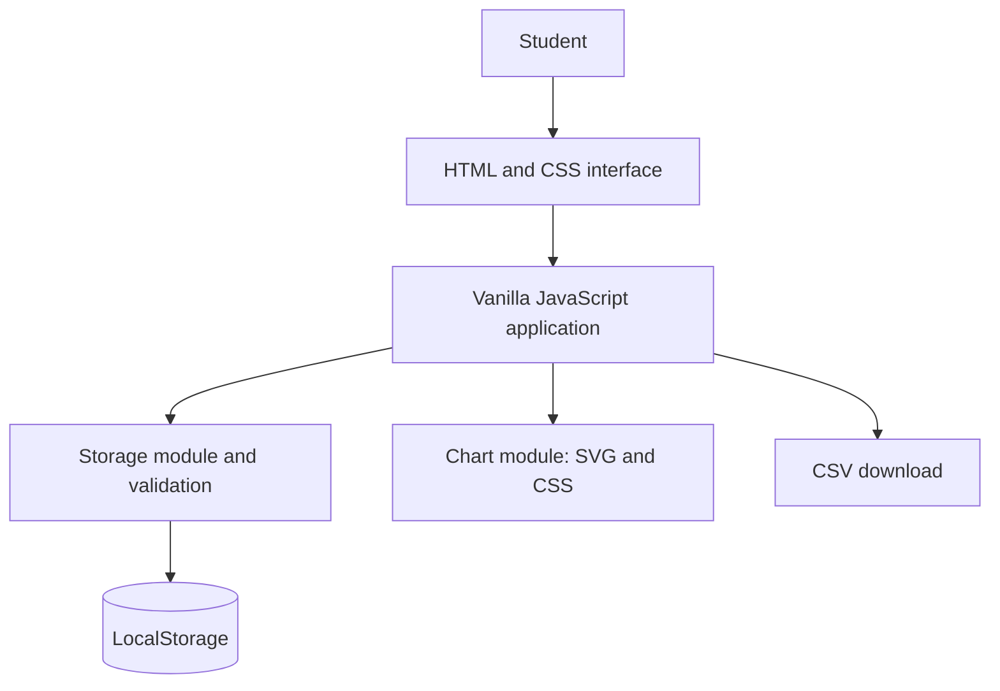

# AAT-1 Project Report: Personal Expense Tracker

## Academic Details

- **Institution:** New Horizon College of Engineering, Bengaluru
- **Subject:** Full Stack Technologies
- **Activity:** AAT-1: Portfolio-Driven Activity
- **Project:** Personal Expense Tracker
- **Student Name:** [Add student name]
- **USN:** [Add USN]
- **Semester / Section:** [Add semester and section]
- **Submission Date:** [Add submission date]

> This report follows the required AAT-1 section list provided with the project instructions. The referenced AAT-1 PDF was not present in the workspace, so exact PDF-specific formatting could not be verified. Replace the labelled student details before submission.

## 1. Project Title

**Personal Expense Tracker: A Web Application for Recording and Analysing Student Expenses**

## 2. Problem Statement and Objectives

Students make frequent purchases for food, travel, learning materials, subscriptions, and other needs. Without a consistent record, it is difficult to understand how smaller expenses accumulate over a month.

The objective is to create a simple, responsive web application that lets a student record and review expenses, recognize spending patterns, and compare current-month expenses with a self-set budget. It should run without a backend, database, account, paid API, or installation of project dependencies.

## 3. Technologies Used

- **HTML5:** Semantic page structure, navigation, transaction table, and forms.
- **CSS3:** Responsive layout, consistent visual design, focus states, and budget indicator.
- **Vanilla JavaScript:** Validation, storage handling, dashboard calculations, filtering, sorting, and CSV export.
- **Browser LocalStorage:** Persists the expense array and monthly budget in the same browser profile.
- **SVG and CSS:** Renders charts without a third-party chart package.
- **Git:** Local version control.

The application does not use a server, database, authentication, AI, or external data API.

## 4. Project Description and Key Features

The dashboard summarizes spending for this month, the last 30 days, or all time. It also shows current-month spending, total transaction count, and the highest-spending category. A six-month bar chart and current-month category chart are calculated from stored transactions.

Students can add, edit, and confirm deletion of expenses. Search, category/month filters, and amount/date sorting help locate transactions. CSV export downloads the currently filtered rows. A monthly limit can be saved; the tracker shows spending progress, warns at 80%, and identifies the excess if spending goes over the budget. Demo transactions can be loaded repeatedly without duplicating existing demo records. Clearing local data requires browser confirmation.

## 5. Data Design

The application uses browser LocalStorage rather than a database. The storage keys are:

1. `pennywise.expenses.v1` — JSON array with `id`, `title`, `amount`, `category`, `date`, `payment`, and `notes`.
2. `pennywise.monthlyBudget.v1` — JSON numeric monthly limit in INR.

The storage module validates object shape, amount, category, payment, title, and calendar date. Malformed or invalid saved values are handled with a user-facing notice. LocalStorage is specific to a browser profile and device; it does not synchronize data and is not an account-based backup.

## 6. Implementation / Methodology

The project separates the interface, local storage, chart drawing, and application interaction logic:

- `index.html` defines navigation, dashboard, filters, transaction list, budget panel, and expense form.
- `css/styles.css` defines layout, responsive breakpoints, controls, table, and chart presentation.
- `js/storage.js` validates and reads/writes expense and budget data.
- `js/charts.js` builds the six-month SVG chart and category doughnut using CSS conic gradients.
- `js/app.js` validates submissions, manages UI state, calculates totals, applies filters/sorts, handles confirmation actions, and exports CSV.

User-provided titles and notes are rendered as text nodes, not injected as HTML. Each change is validated before persistence and the dashboard is re-rendered from the saved application state.

## 7. System Architecture



## 8. Development Steps

1. Inspected the initially empty workspace and checked for an existing repository.
2. Implemented the semantic page and responsive style system.
3. Added LocalStorage validation, CRUD interactions, computed dashboard metrics, charts, budget tracking, filters, and CSV export.
4. Added sample data, empty states, confirmations, accessibility labels, and user notifications.
5. Performed the verification steps recorded in the delivery summary.

The AAT-1 PDF and screenshot evidence were not supplied in the workspace. Do not describe PDF review or evidence capture unless those artifacts are subsequently added.

## 9. Component Interface or Function Descriptions

### `ExpenseStorage` (`js/storage.js`)

- `readExpenses()` and `readBudget()` parse and validate saved values.
- `saveExpenses(expenses)` validates every item before writing the array.
- `saveBudget(budget)` validates and saves or removes the budget.
- `normalizeExpense(value)` enforces the stored expense shape.

### `ExpenseCharts` (`js/charts.js`)

- `renderMonthly(container, expenses, now)` draws totals for the six latest calendar months.
- `renderCategories(container, legend, expenses, now)` draws the current-month category chart and returns its total.

### Application (`js/app.js`)

- `render()` refreshes summary, transaction rows, and budget status.
- Form submission validates then adds or updates one expense.
- Search/filter/sort controls derive the visible transaction set without changing saved data.
- Budget, demo, delete, clear, and CSV controls perform their respective actions with status feedback.

## 10. Application Workflow

1. On load, the application reads and validates LocalStorage values.
2. The dashboard calculates totals and generates charts from valid expenses.
3. A submitted expense is checked, normalized, saved, then reflected throughout the interface.
4. Search and filters select matching transactions; sort controls order those results.
5. Budget progress is computed using current-calendar-month expenses.
6. CSV export creates a local file from the currently filtered results.

## 11. Important Code Snippets

### Validated expense amount and date (`js/storage.js`)

```js
const amount = Number(value.amount);
if (!id || !title || !Number.isFinite(amount) || amount <= 0 ||
    amount > 100000000 || !validDate(value.date)) return null;
```

### Saving expense changes (`js/app.js`)

```js
const existing = state.expenses.some((expense) => expense.id === id);
const next = existing
  ? state.expenses.map((expense) => expense.id === id ? entry : expense)
  : [entry, ...state.expenses];
if (saveExpenses(next)) {
  notify(existing ? "Expense updated." : "Expense added.");
  resetExpenseForm();
}
```

### Budget threshold status (`js/app.js`)

```js
if (ratio > 1) {
  status.textContent = "Budget exceeded by " +
    money.format(monthTotal - state.budget) +
    ". Review this month's spending.";
} else if (ratio >= 0.8) {
  status.textContent = "Heads up: you've used " + percentage +
    "% of this month's budget.";
}
```

## 12. Output Screenshots

The following genuine screenshots were captured from the running application using sample transactions:

### Main dashboard


### Transaction management and edit form


### Budget and analytics


## 13. GitHub Repository Screenshot and Link

- **Repository URL:** Not published at the time of report preparation.
- **GitHub repository screenshot:** Not available; capture only after a repository is actually published.

## 14. Repository Structure

```text
personal-expense-tracker/
├── index.html
├── css/
│   └── styles.css
├── js/
│   ├── app.js
│   ├── charts.js
│   └── storage.js
├── docs/
│   └── project-report.md
├── assets/
│   └── screenshots/
│       ├── dashboard.png
│       ├── transactions.png
│       └── budget-analytics.png
├── .gitignore
├── LICENSE
└── README.md
```

## 15. Steps to Run the Project

1. Open `index.html` in a modern browser. If local file restrictions apply, serve the folder with a static web server or VS Code Live Server.
2. Select **Load demo data** to see sample records and analytics.
3. Add or edit records using the form; the application saves them in this browser.
4. Refresh the page to verify LocalStorage persistence.

For a static local server, run `python -m http.server 8000` in the project folder and open `http://localhost:8000`. No package installation or backend configuration is required.

## 16. Challenges Faced

During responsive browser verification, the transaction table initially caused horizontal overflow on narrow screens. The mobile layout was adjusted to fit the available width and hide the payment-method column at the smallest breakpoint. The 390 px viewport was re-tested with no page-level horizontal overflow.

LocalStorage can still be unavailable, full, malformed, or cleared by browser settings; the app displays a notice for malformed saved data and reports write failures. LocalStorage is not a cross-device synchronization or backup solution.

## 17. Learning Outcomes and Conclusion

The project demonstrates how HTML, CSS, and browser JavaScript can form a useful client-side application. It applies form validation, state rendering, LocalStorage persistence, data-derived dashboard totals, chart rendering, accessible interaction patterns, and CSV generation. The finished design provides students with a lightweight tool for reviewing their own spending while accurately explaining the limits of local browser storage.

## 18. Future Enhancements

- Validated CSV import and backup restore.
- Optional recurring transactions and custom categories.
- Configurable reporting periods and printable reports.
- A carefully designed opt-in encrypted backup, if required.
